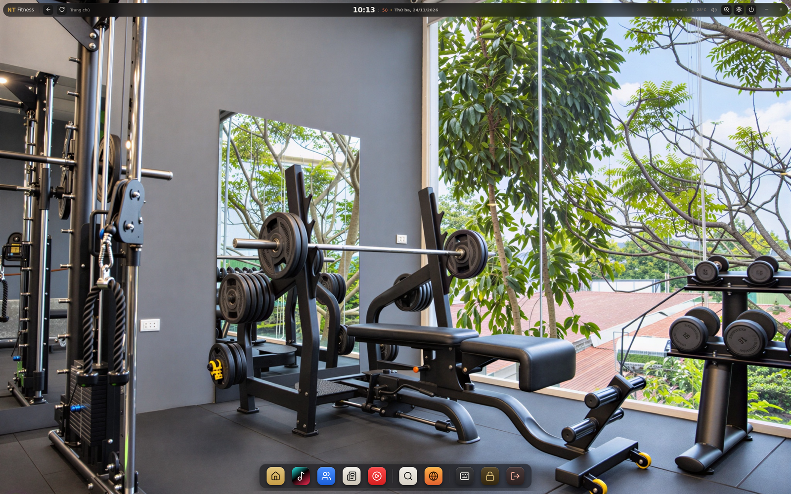
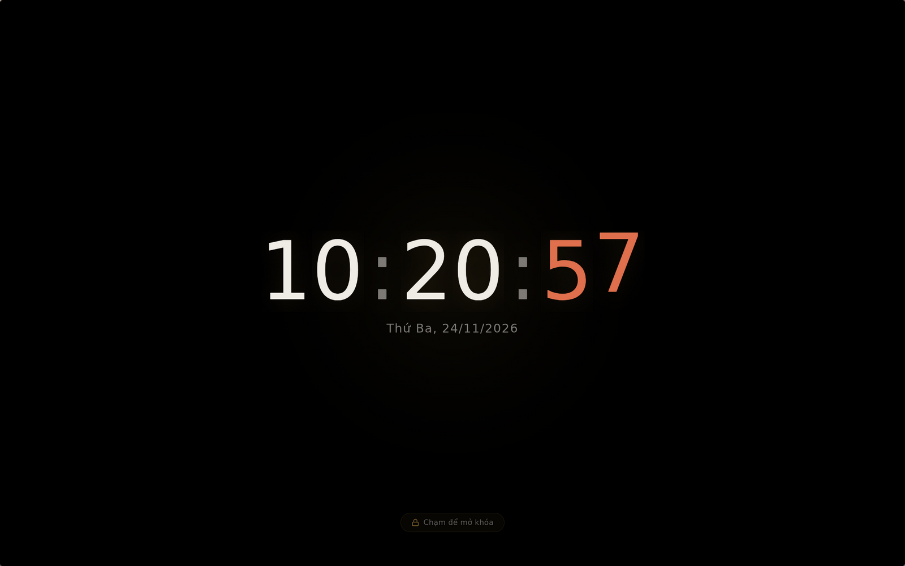
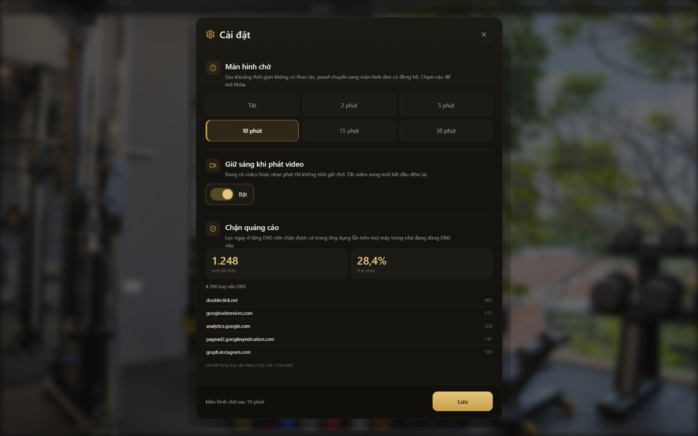
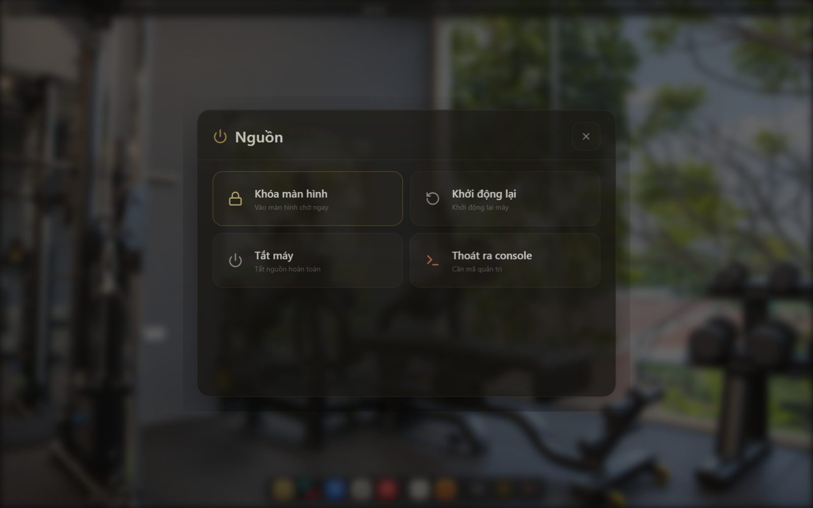
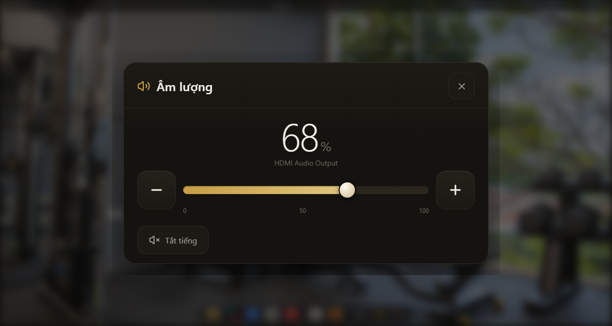
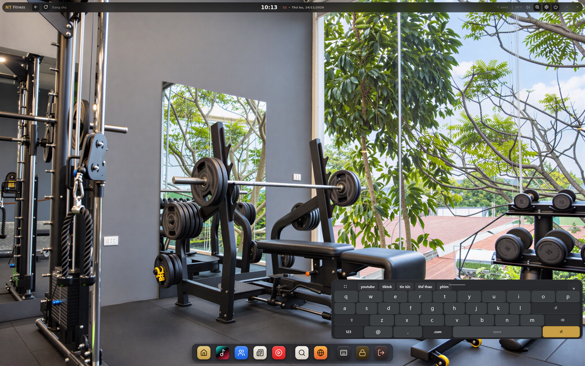

# Ubuntu Touch Kiosk — Wayland Touchscreen Launcher (Electron + labwc)

[](https://www.electronjs.org/)
[](https://www.typescriptlang.org/)
[](https://labwc.github.io/)
[](https://ubuntu.com/)
[](https://nodejs.org/)
[](LICENSE)

**Ubuntu Touch Kiosk** is a production-ready **Wayland touchscreen kiosk launcher** built with **Electron**, **TypeScript**, and **labwc** for wall-mounted tablets, gym media displays, smart home panels, and interactive Linux kiosks. It combines a persistent translucent pill top bar, a macOS-style floating touch dock, an Apple-inspired draggable virtual keyboard, edge-swipe navigation gestures, a morphing-digit black screensaver lock screen, hardware-aware video decoding, and household DNS ad-blocking via AdGuard Home.

> **Giao diện kiosk cảm ứng Ubuntu Wayland mã nguồn mở** (Electron 45 + TypeScript + `labwc`), tối ưu cho màn hình cảm ứng treo tường, bảng điều khiển phòng gym hoặc màn hình giải trí gia đình. Tích hợp thanh trạng thái viên thuốc đồng hồ giây đỏ, dock ứng dụng nổi, bàn phím ảo kéo thả không cướp focus, cử chỉ vuốt cạnh, khung bo góc cho app ngoài (`FreeTube`, `Firefox`, `Chromium`), màn hình chờ tối tiết kiệm điện, và chặn quảng cáo toàn mạng bằng AdGuard Home.

---

## Screenshots / Hình ảnh giao diện

| Home Screen & Floating Dock / Màn hình chính | Lock Screen (Morphing Digit Clock) / Màn hình chờ |
| :---: | :---: |
|  |  |

| Settings & AdGuard DNS Stats / Cài đặt & Chặn quảng cáo | Sudo-Verified Power Panel / Thẻ Nguồn |
| :---: | :---: |
|  |  |

| PipeWire Volume Control / Thẻ Âm lượng | Draggable On-Screen Virtual Keyboard / Bàn phím ảo |
| :---: | :---: |
|  |  |

---

## Key Features / Tính năng nổi bật

- **Translucent Pill Top Bar / Thanh trên viên thuốc:** Always-visible top bar with synchronized 24h clock + red seconds (`Asia/Ho_Chi_Minh`, `hourCycle: "h23"`), wired/Wi-Fi network status, CPU temperature, quick Back / Reload / Close Front App controls, and floating card triggers.
- **Touch-First Floating Dock / Dock cảm ứng nổi:** 10-tile macOS-style dock using pointer-drift tap detection (`14 px` slop / `700 ms` hold) so taps never drop on capacitive touch panels (`Home`, `TikTok`, `Facebook Reel`, `News`, `FreeTube`, `Google Search`, `Browser`, `Keyboard`, `Lock`, `End Session`).
- **Rounded External App Framing / Đóng khung app ngoài dưới labwc:** Launches **FreeTube** (Wayland), **Firefox** (Wayland + GTK CSD shadow removal), and **Chromium** (XWayland) inside a pinned content band (`FRAME_INSET=10`, `TOP_BAR=44`, `DOCK=96`) using 9 click-through always-on-top corner/ring windows (`src/main/frame-window.ts`), while keeping the kiosk pinned to `always-on-bottom`. Automatic fallback to `cage` if `labwc` is unavailable.
- **Draggable & Resizable Virtual Keyboard / Bàn phím ảo nổi:** Apple-style touch keyboard (`src/renderer/keyboard/`) injected via `sendInputEvent` without stealing focus from web or external inputs, supporting quick suggestion chips, height resize grip (`250–470 px`), and drag repositioning.
- **Wayland Touch & Video Swipe Gestures / Cử chỉ cảm ứng mượt:** Renderer/preload pointer recognizer (`src/main/preload-gesture.cts`) supporting **left-edge Back swipe**, **bottom-edge Home swipe**, and **vertical video swipe** (`preload-video-swipe.cts`) for TikTok `/foryou` and Facebook Reels while preserving inner comment scrolling.
- **Morphing-Digit Lock Screen & `evdev` Idle Watch:** Pure black screensaver with 6-slot rolling odometer digits (`clock-digits.ts`), anti-accidental-unlock arming delay, and `/dev/input/event*` `evdev` activity monitoring (`idle-watch.ts`) that detects touch even inside external apps, plus optional keep-awake during media playback.
- **Floating Control Cards / Bốn thẻ nổi độc lập:**
  - **Volume (`volume-panel`):** PipeWire/WirePlumber (`wpctl`) slider, `±5%` touch buttons, mute toggle.
  - **Text Size (`zoom-panel`):** Discrete `100% / 125% / 150% / 200%` zoom levels (`ZOOM_ORDER`).
  - **Settings (`settings`):** Screensaver timeout presets, media keep-awake switch, and read-only AdGuard DNS block stats.
  - **Power (`power`):** Instant screen lock plus 5-attempt rate-limited `sudo -k -S -v` PIN gate for Reboot, Shutdown, and Exit to Console (zero passwords stored on disk).
- **Household DNS Ad-Blocking & Auto Maintenance:** Automated AdGuard Home setup (`IPv4` + dynamic `IPv6` prefix sync timer) and weekly unattended `apt` maintenance timer (`Sun 03:00`, `Persistent=true`) with lock/reboot protection.

---

## Project Structure / Cấu trúc dự án

```text
├── assets/                 # Default studio wallpaper copied into dist/assets/
├── docs/                   # Architecture, AdGuard DNS, GPU/video acceleration & UI screenshots
│   ├── screenshots/        # Verified UI screenshots embedded in README
│   ├── adguard-dns.md      # AdGuard Home setup, router DHCPv4/IPv6 notes, Query Log guide
│   ├── chrome-layout.md    # Window framing geometry, 9-window corner masks, clock spec
│   └── video-acceleration.md # GPU compositing vs VA-API benchmarks and NVIDIA/iGPU guide
├── scripts/                # Build helpers & Ubuntu kiosk ops (systemd, labwc, AdGuard, doctor)
├── src/
│   ├── main/               # Electron main process, compositor rules, security, IPC, preloads
│   ├── renderer/           # Sandboxed UI windows (shell, keyboard, lock, frame, 4 floating cards)
│   └── shared/             # Single-source constants, clock formatter, service specs, IPC contracts
└── tests/                  # Node.js unit & regression tests (94 cases)
```

---

## Requirements / Yêu cầu hệ thống

- **OS:** Ubuntu 26.04 LTS (or Debian/Ubuntu with Wayland)
- **Compositor:** `labwc` (`0.9.x` with `+xwayland`) + `seatd` (automatic fallback to `cage` `0.2.x` via `NTF_COMPOSITOR=cage`)
- **Runtime:** Electron `45.x` (`chrome-sandbox` owned by `root:root` mode `4755`, **never** `--no-sandbox`)
- **Build & Test:** Node.js `>= 22.12.0` (`npm ci`, TypeScript `5.7`)
- **Optional Kiosk Apps:** `freetube` (external `.deb`, AGPL-3.0, launched detached only), `firefox` / `chromium`, `wlrctl`, `wpctl`, `grim`

---

## Quick Start / Cài đặt & chạy thử

```bash
git clone https://github.com/nguyenthanhstd/ubuntu-touch-kiosk.git
cd ubuntu-touch-kiosk

# Install dependencies and compile TypeScript + inline sandboxed preloads + copy assets
npm ci
npm run build

# Typecheck & run all 94 unit tests
npm run typecheck
npm test
```

Launch a local test session on the target panel (auto-detects seat & Wayland runtime):

```bash
./scripts/run-test.sh      # writes logs to /tmp/ntf-run.log
./scripts/stop.sh          # clean teardown without leaving orphan processes
```

---

## Production Setup on Ubuntu Kiosk / Triển khai trên máy kiosk thật

### 1. Autostart & Polkit Power Policy (`systemd --user`)

```bash
export NTF_SUDO_PASS='<your-sudo-password>'
./scripts/install-autostart.sh --apply      # installs systemd user unit + linger + GTK CSD css
./scripts/install-power-policy.sh --apply   # allows kiosk user reboot/poweroff via polkit
systemctl --user status ntfitness-kiosk
```

> **Note:** `uninstall-autostart.sh --apply` removes the unit while intentionally keeping `linger` active so SSH sessions are not terminated. If you exited to console manually, restart the UI via:
> ```bash
> export XDG_RUNTIME_DIR=/run/user/$(id -u)
> export DBUS_SESSION_BUS_ADDRESS=unix:path=$XDG_RUNTIME_DIR/bus
> systemctl --user reset-failed ntfitness-kiosk
> systemctl --user start ntfitness-kiosk
> ```

### 2. External Apps & Weekly Maintenance

```bash
export NTF_SUDO_PASS='<your-sudo-password>'
./scripts/install-apps.sh --apply           # installs FreeTube (.deb) and Firefox (snap)
./scripts/install-maintenance.sh --apply    # schedules Sunday 03:00 apt update/upgrade timer
./scripts/close-apps.sh --apply             # safely terminates external apps by cmdline prefix
```

### 3. DNS Ad-Blocking (AdGuard Home)

```bash
export NTF_SUDO_PASS='<your-sudo-password>'
./scripts/install-adguard.sh --apply        # binds AdGuard DNS on LAN IP + 8.8.8.8 failover
./scripts/install-adguard-ipv6.sh --apply   # syncs dynamic ISP IPv6 prefix every 5 minutes
./scripts/install-adguard-status.sh --apply # publishes read-only JSON stats for Settings card
```

See **[docs/adguard-dns.md](docs/adguard-dns.md)** for full router DHCPv4/IPv6 setup, static `/etc/resolv.conf` safety rules, and Query Log usage.

### 4. Diagnostics & Probes / Chẩn đoán hệ thống

```bash
./scripts/ntf-doctor.sh                     # CPU temp, RAM, compositor, GPU/VA-API decode status
./scripts/ntf-doctor.sh --watch             # refresh every 2 seconds
```

Automated Electron hardware/compositor probes (run inside `labwc` or `cage` on the target device):

```bash
E=./node_modules/.bin/electron
labwc -S "$E dist/main/main.js --ntf-probe"                  # 14 core layout/IPC/security checks
labwc -S "$E dist/main/main.js --ntf-probe-player"           # 1080p/1440p H.264 decode check
labwc -S "$E dist/main/main.js --ntf-probe-shot /tmp/shot"   # capture top/dock/nav PNGs
```

---

## Architecture & Security Design / Kiến trúc & Bảo mật

- **Sandboxed Preload Inlining:** Under Electron 45 sandbox, preload scripts may only `require('electron')`. `scripts/fix-preload.mjs` inlines shared gesture modules (`preload-gesture.cts`, `preload-video-swipe.cts`) at build time.
- **Wayland Touch Handling:** On `cage`/`labwc` + Electron 45, main-process `input-event` does not receive touch events; all gesture recognition runs cleanly inside renderer preloads and reports via sender-validated IPC (`isTrustedGestureSource`).
- **Zero Stored Secrets:** Admin actions (Restart, Shutdown, Exit to Console) validate the OS `sudo` password one-way through `sudo -k -S -v` stdin (`src/main/sudo-check.ts`) with a 5-attempt lockout (`src/main/code-guard.ts`). AdGuard Home stats flow through a read-only root-generated JSON file so untrusted web views can never access admin credentials.
- **Detailed Technical Docs:**
  - **[Chrome Layout & Corner Masks](docs/chrome-layout.md)**
  - **[AdGuard Home DNS & IPv6 Guide](docs/adguard-dns.md)**
  - **[Video Smoothness, GPU Compositing & VA-API](docs/video-acceleration.md)**

---

## License / Giấy phép

Distributed under the **MIT License**. See [LICENSE](LICENSE) for full terms.
*(FreeTube is an external optional application under AGPL-3.0 launched via detached process only; no AGPL source code is bundled in this repository.)*
